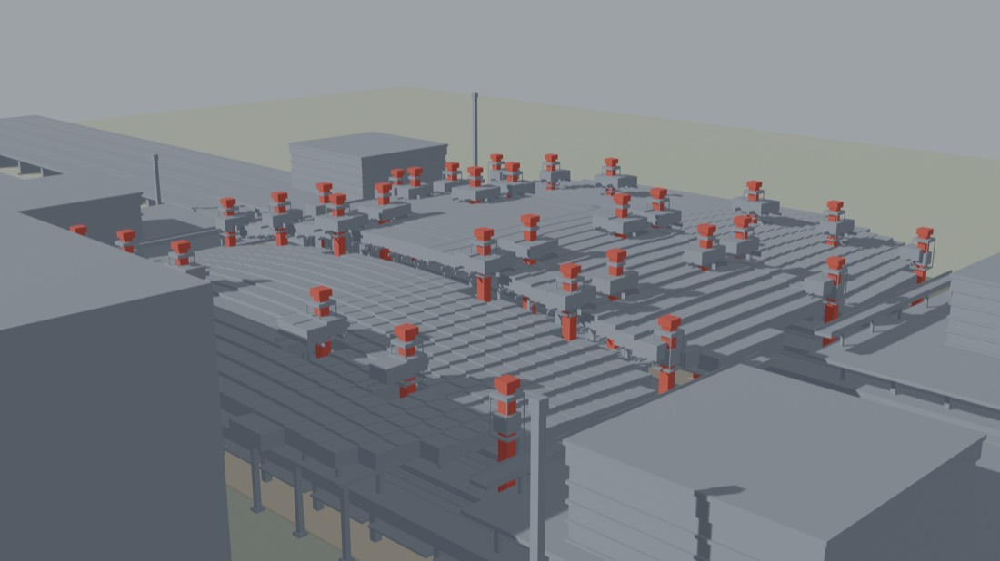
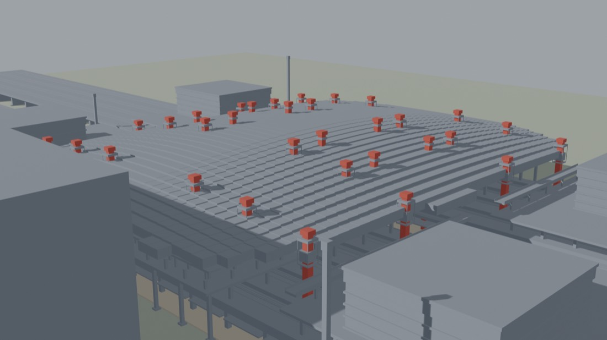
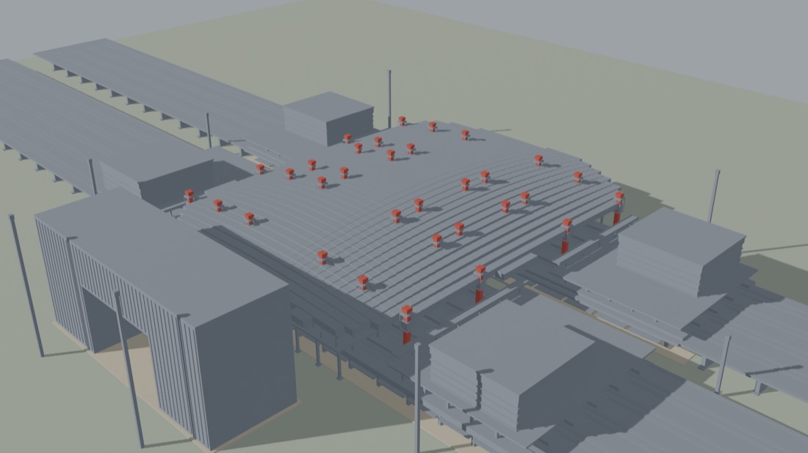
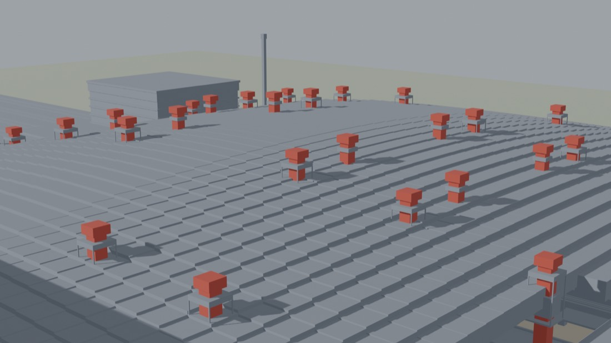
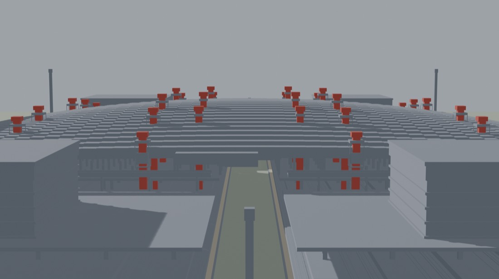
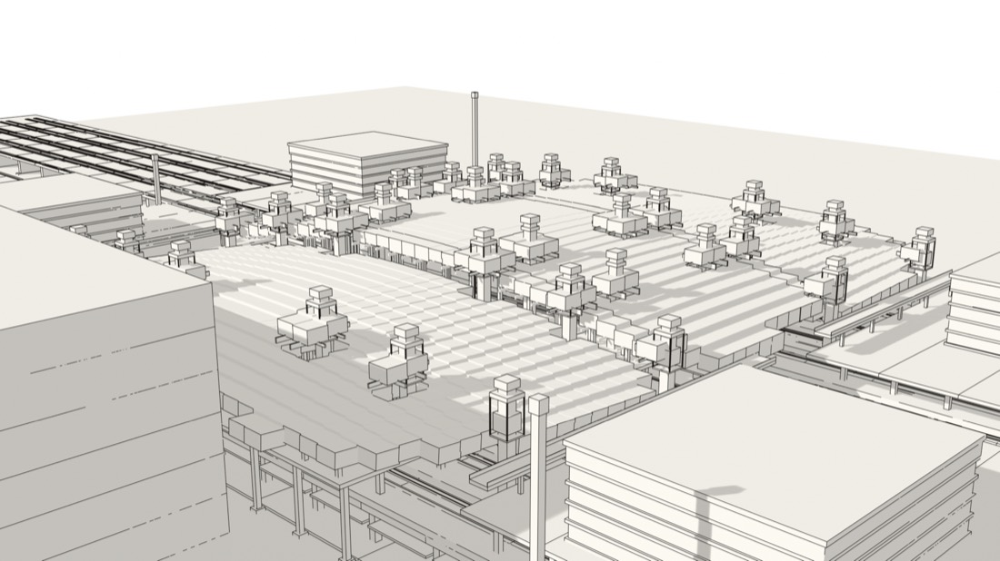
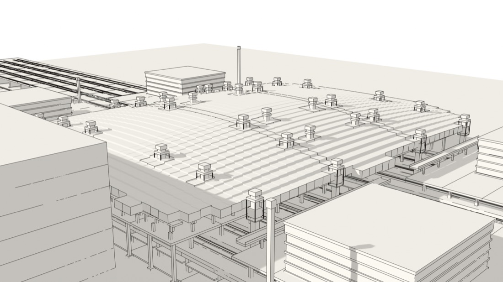
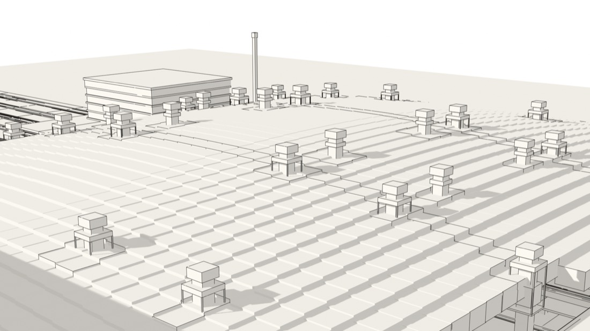

# 2026-11-08 Blender 参考渲染实验（Tibo 外挂侧）

定位：本件**不认领** `docs/tasks/blender-ref.md` 与 `docs/tasks/blender-final.md`。这是图册外挂侧（Tibo 调度、本地 Gemini 4 执行）的先行实验：先验证「同一份 HZ 几何 → Blender 渲染」这条管线通不通、数据口径怎么对齐，把坑探出来，供日后认领那两张卡的人直接复用。脚本在 `blender/`，全尺寸图未入库（见文末）。

## 管线

1. `blender/export_geometry.js`：经仓库自带 `tools/hz/harness.js` 加载 HZ、`HZ.make()` 后导出 `geometry.json`（中间产物，不入库，命令见 blender/README.md）。
2. `blender/build_scene.py`：Blender 5.2.2 LTS 无头运行（Apple M4 / Metal），EEVEE 渲染 1920×1080。盒按材质合并成少数 Mesh、屋盖格按分区着色、提升器做塔柱＋顶帽。

## 数据口径（与仓库基线对齐）

- 静态盒 7334、屋盖格 1432、提升器 32，与 `tools/hz/check_make.js` 基线一致。
- 成品态取 t=660（`HZ.xf` 为恒等，几何即原始坐标）。
- 拼装态取 t=620，经 `HZ.xf(pose, grp, ·)` 逐角真实变换。**注意：`pose` 里的 dy 只是提升行程分量（全程 −5.8 → 0，总行程 D=5.8m），不是分区姿态本身**；完整姿态必须走 xf——实测最终高 55m 的屋盖点在拼装态：1/3 区（南北两翼）内缘垂下到约 27m（绕外缘旋转约 28m 落差），2/4 区约 49m。只按 dy 平移会把拼装态画错（外挂侧 v1 就只做了 −5.2 平移，本件 v2 已纠正）。
- 近似：屋盖格薄板厚度 1.4m 为假定值；拼装态下静态盒（grp=0）与提升器不随姿态变化，与宿主 3D 的口径一致到构件级、不到钢绞线级。

## 图（缩略图，全尺寸见文末）

同机位对比组（机位 (305, 150, 305) → (0, 26, 0)，42mm）——本件的核心结论图：

- 拼装态 t=620：南北两翼垂下、屋盖面断开成错台，提升器塔身大段露出。

- 成品态 t=660：屋盖齐平合拢，提升器只剩塔帽在屋面上。

成品三视角（v2 机位）：

## 结论与教训

1. 管线成立：HZ 几何可完整导出并在 Blender 里成场，计数、位置与页面数据一致（提升器位置与平面图逐个对得上）。
2. 拼装↔成品的戏剧性不在高度（只有 5.8m 行程），在**两翼旋转**：对比组必须用 xf 真实姿态，单按 dy 平移讲不出这个故事。
3. 鸟瞰机位要够高够远：v1 机位 (330, 60, 330) 被站体边墙挡掉三分之一画面；v2 改 (430, 330, 430) 后全场入镜。
4. 本件是白模/灰盒参考渲染——与页面墨线语言的差距、云纹深度、亮灯样子，正是 blender-ref 要回答的问题，本件不越界下结论，只提供几何与机位口径。
5. 分区色在 EEVEE 平光下读不出来（四区几乎同色），要区分只能靠光影方向与明暗，不是堆饱和度。

## 全尺寸图与中间产物

全尺寸 PNG（11 张：v1 三张＋v2 五张＋线稿三张，1920×1080）与 geometry.json 在执行机 Mac 的 `~/hz-blender-lab/renders/` 与 `~/hz-blender-lab/geometry.json`，按 blender/README.md 的两条命令可随时再生，故不入库。

## 线稿对照（D-10 补齐）

白模之外同机位补线稿三张（脚本 `blender/build_lines.py`，Blender 5.2.2 的 Freestyle 在本机 EEVEE_NEXT 下可用：Silhouette＋Crease，屋盖格边以角度阈值收紧、只留带状分区感）：

结论：线稿下拼装↔成品的差异仍然可读（屋面连续性、提升器露出量）；线稿离页面墨线语言比白模近得多——屋盖格只剩轮廓与带状阴影，不淹没主体。这条 Freestyle 路线可供终版精修（D-11）的墨线风格直接沿用。全尺寸图在执行机 `~/hz-blender-lab/renders/`（pair_asm_line.png、pair_final_line.png、view_b2_line.png）。
